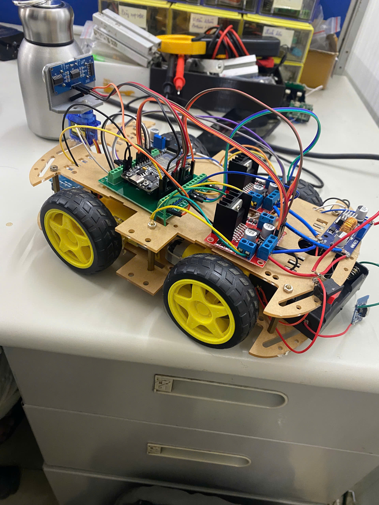

# Follower Line Robot

A line-following robot based on ESP32, using infrared sensors and PID control.

## 1. Introduction

This project focuses on developing an autonomous line-following robot.


The robot uses an ESP32 microcontroller to read infrared sensors and control DC motors to follow a predefined path.

## 2. Hardware Requirements

The main hardware components include:

- ESP32 DevKit V1
- 3 channel follower-line sensor
- L298N motor driver
- DC motors
- Robot chassis
- Power supply 12v

## 3. Software Requirements

- Arduino IDE
- ESP32 Arduino Core
- C/C++ main language

## 4. Wiring Diagram

This section describes the electrical connections between the ESP32, sensors, motor driver and other hardware components.

**Pin configuration:**

| Component | ESP32 GPIO |
|---|---|
| Motor driver | See config.h |
| Line sensors | GPIO 33, 32, 35, 34, 36 |

## 5. Control Algorithm

The robot uses PID (Proportional-Integral-Derivative) control to follow the line.

The five infrared sensors detect the line position and calculate the tracking error.

The PID controller uses this error to adjust the speed of the left and right motors.

## 6. Installation

### Clone repository

```bash
git clone https://github.com/HaIBotLab/follower-line-robot.git
```

### Open project

Open the project directory using Arduino IDE.

### Upload firmware

1. Connect ESP32 to the computer.
2. Select the appropriate ESP32 board.
3. Select the correct COM port.
4. Compile and upload the firmware.

## 7. Project Structure

```text
follower-line-robot/
├── main/
├── config.h
├── README.md
└── ...
```

Update this structure to match the actual project files.

## 8. Demo

This section contains images and videos demonstrating the robot's operation.

### Robot Overview


## Author

NguyenHoangSon